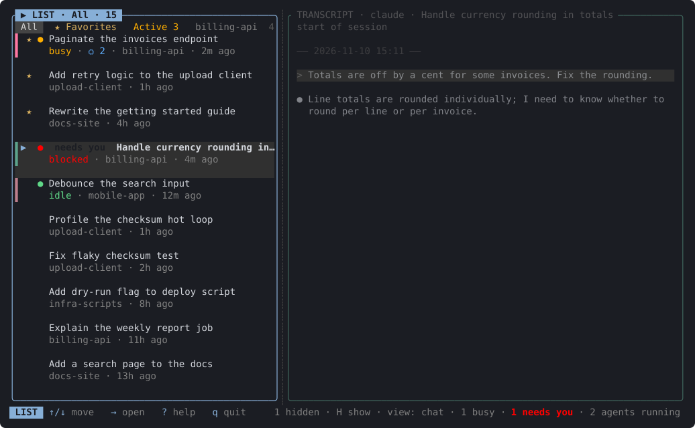
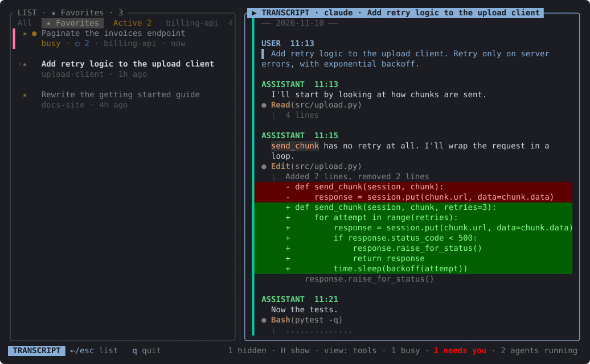
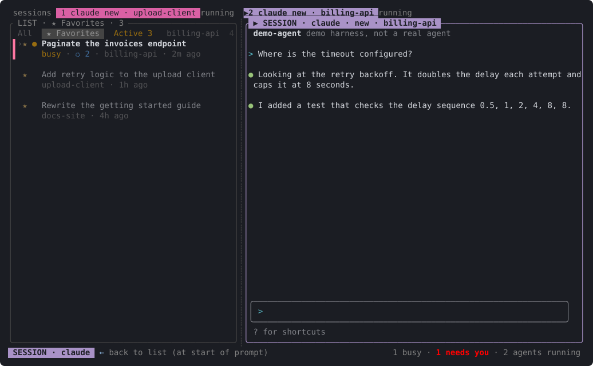

# ccview-rs

A terminal UI for keeping track of your coding-agent sessions.

If you use Claude Code, Codex or OpenCode across a handful of projects, you end up with a pile of sessions and no good answer to "which one was I in, which is waiting on me, where did that conversation go?" ccview-rs puts them all in one list, shows what is running, lets you read any transcript, and lets you resume, fork or start a session from the same screen.



## What it does

- One list of every session, newest first, with a tab for each project directory, your favourites and everything that is running.
- Shows which Claude sessions are busy, idle or waiting for you, and how many sub-agents they have going.
- Reads a transcript with markdown, diffs and tool calls. `v` switches between chat, tools and everything.
- Resumes, forks or starts a session in an embedded terminal pane. The real agent runs in it, so it behaves as it always does, and it keeps running if you quit ccview-rs and come back later.
- Lets you star, hide and colour sessions. Several copies of one conversation fold into a single row.





## How it works

It keeps no sessions of its own. It reads what the agents already write: Claude's transcripts and live registry, Codex's rollout files and OpenCode's database (read-only). A background thread indexes them, so it starts fast and the list catches up within about a second of anything changing.

Embedded sessions are real pseudo-terminals. The agent runs in a PTY and ccview-rs draws its screen through a terminal emulator, so keys, colours, paste and mouse work like they do in a normal terminal. A small background process owns those PTYs, which is why sessions survive quitting the UI. ccview-rs makes no network calls itself.

## How it is built

Rust and [ratatui](https://ratatui.rs), as a library with a thin binary. Scanning, following transcripts and polling live status each run on their own thread and feed the UI over channels; the UI thread never touches files or processes. Every agent sits behind a small `Harness` trait and its own session reader, so supporting another one means adding a file, not changing the rest. Conventions and the safety rules for contributors are in [AGENTS.md](AGENTS.md).

## Try it

```sh
cargo install --path .
ccview-rs
```

Press `?` for the keys and `,` for settings. `ccview-rs --export out.html` writes a transcript to HTML, Markdown or JSONL.

Unix only, with macOS as the main target. It is an early personal project: Claude Code is the best supported, Codex and OpenCode are thinner. The screenshots use invented data and can be rebuilt with `docs/screenshots/regenerate.sh`.
