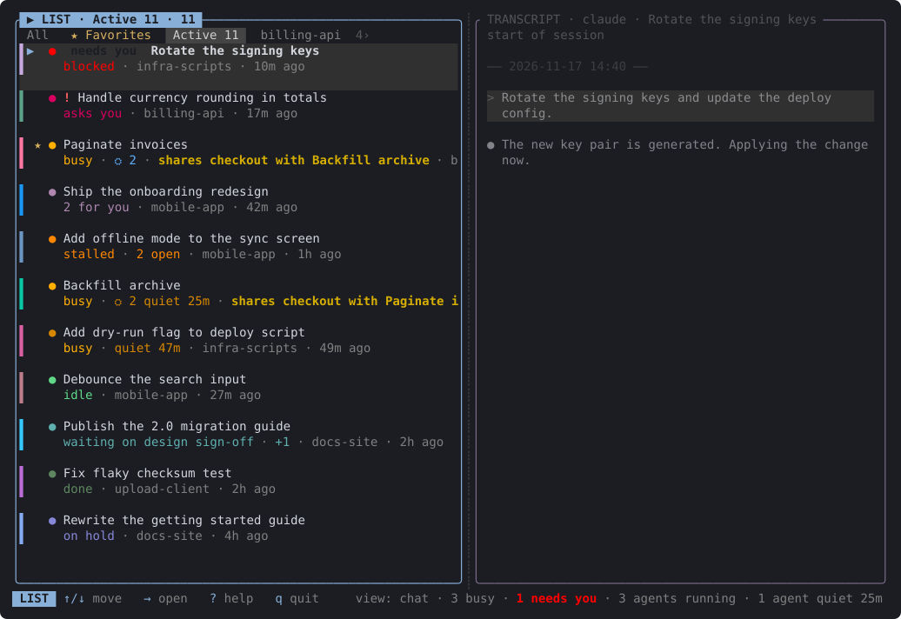
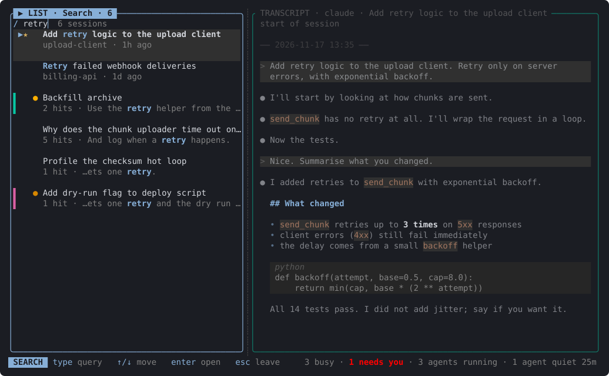
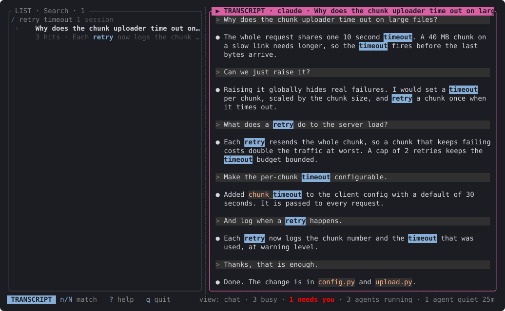
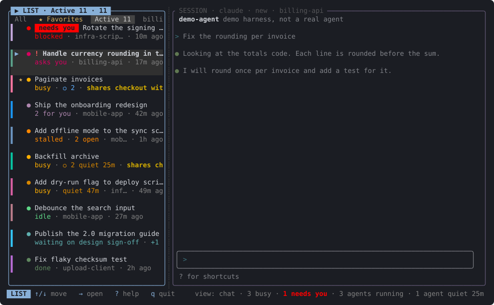

# ccview-rs

A terminal UI for keeping track of your coding-agent sessions.

If you use Claude Code, Codex or OpenCode across several projects you end up with a pile of sessions and no good answer to "which one is waiting on me, which one is stuck, where did that conversation go?" ccview-rs puts them in one list, shows what each one is doing, lets you search and read any transcript, and lets you resume, fork or start a session from the same screen.



The Active tab. From the top: needs you, asks you (important, `!`), busy with two sub-agents and a shared checkout (starred, so it sits above the rest), 2 for you, stalled, busy with a quiet sub-agent, a busy session quiet for 47 minutes, idle, waiting on, done, on hold.

## What it does

**The list.** Every session, newest first, with tabs for All, Favorites, Active and one per project directory. Order inside a tab: important (`i`, drawn as `!`), starred, then recency; the Active tab puts sessions that need you first and then ranks by attention (asks you, N for you and stalled, then busy, idle, waiting on, done, on hold). `d` stops a session and removes it from Active, after a `y/n` confirm; `D` undoes a dismissal. Drag a row, or use `Alt+Up/Down`, to set your own order within a class; `R` resets it. `w` puts a session on hold, which replaces `idle` with `on hold` until you press `w` again or reply to it.

**What idle means.** `idle` means nothing is known to be outstanding. For an idle Claude session the status word is, highest first:

| Shows | Means |
|---|---|
| `asks you` | the last reply ends on a question (heuristic, reads the prose) |
| `N for you` | hand-offs in the session's definition-of-done file are owed to you; it clears when you reply after the file's last edit |
| `waiting on <label>` | the file has an open wait on someone else |
| `stalled · M open` | nothing owed or waited on, but M items are still open |
| `done` | the file has nothing open anywhere |
| `idle` | none of the above, or no file |

A busy session shows `quiet 47m` after 30 minutes without output (heuristic: a long silent tool call looks the same). A running sub-agent that has written nothing for 10 minutes makes the badge read `quiet 25m` (heuristic). Two active sessions of different conversations in one git checkout get `shares checkout with …` (heuristic, by directory).

**Hand-offs from definition-of-done files** are optional. If `~/.claude/dod/<date>-<session id>.md` exists (or under `$CLAUDE_CONFIG_DIR`), ccview-rs reads it; if not, nothing changes. The format is checklist lines, `- [ ]` open, `- [x]` done, `- [~]` waived, and hand-offs:

```
- [>] approve the final copy — owner: you — action: reply ok or send edits — why not mine: product decision
- [>] security review — owner: security-team — waiting on security review
```

Close a hand-off by writing `[>x]`. Set `"handoff_owner": "you"` (comma-separated names) in `~/.config/ccview-rs/ui.json` and restart, so other owners count as waits instead of hand-offs. `N for you` and `stalled` look at the newest `## Amendment` section; waits and `done` look at the whole file. A session that never writes the file stays `idle`. Settings has an on/off switch.



**Search.** `/` searches names and transcript text of every loaded session (by default those active in the last 30 days; `Load sessions from the last` in settings). Name matches come first, then fuzzy title matches, then text hits with `N hits` and a snippet with the words marked. Plain words are ANDed; `"phrase"`, `foo*`, `-word`, `dir:`, `title:`, `harness:` and `in:prompt|reply|tool` work. Enter opens the best match in the transcript with every query word highlighted, and `n`/`N` step to the next and previous matching message. Esc clears the highlight, then returns to the results, then leaves search.



**Reading.** Transcripts open on the latest 200 messages and page in older ones as you scroll, so a large file is not read from the start. `v` switches between chat, tools (Claude Code's own layout, results collapsed) and everything. Links are clickable. Selecting text copies it (needs a terminal with OSC 52).


**Running sessions.** `r` resumes, `f` forks, `n` starts, `c` continues in an embedded pane. The real agent runs in it. Sessions belong to a small background host process, so quitting ccview-rs, or a crash, leaves them running. `ccview-rs autostart on` installs a macOS LaunchAgent that, after a reboot, resumes the sessions that were open and have a session id (at most 12).


**Updating.** When the installed binary changes on disk the UI restarts itself in place and keeps your tab, selection and scroll. It waits while you are in an embedded session, a dialog or a search. `Restart on update` in settings turns it off.



## How it works

It keeps no sessions of its own. It reads what the agents write: Claude's transcripts, live registry and sub-agent files, Codex's rollout files, OpenCode's database (read-only). Background threads scan, follow and index them, so it starts fast and the list catches up within about a second. Scanning, transcript reading, indexing and search never run on the UI thread. The search index is a SQLite file in the cache directory holding every word of the transcripts it covers, so treat it like the transcripts.

Embedded sessions are real pseudo-terminals owned by the host process; ccview-rs draws their screens through a terminal emulator, so keys, colours, paste and mouse behave as in a normal terminal. Only one ccview-rs at a time holds a session's input. ccview-rs makes no network calls itself.

## How it is built

Rust and [ratatui](https://ratatui.rs), as a library with a thin binary. Every agent sits behind a `Harness` trait and its own session reader, so another agent means adding a reader and a `Harness` implementation. Architecture, product decisions, known limits and the safety rules for contributors are in [AGENTS.md](AGENTS.md).

## Try it

```sh
cargo install --path . --locked
ccview-rs
```

`?` shows the keys, `,` the settings. `ccview-rs --export out.html` writes a transcript to HTML, Markdown or JSONL.

The pictures are synthetic: invented sessions, a fake agent, no real data. `docs/screenshots/regenerate.sh` rebuilds them by driving the release binary in a pseudo-terminal.

## Limits

- Unix only, macOS is the main target. External terminals (`o`) and autostart are macOS only.
- Early personal project. Claude Code is the best supported. `asks you`, hand-offs, sub-agents, quiet and shared-checkout markers are Claude only; Codex and OpenCode rows show the basics, and an OpenCode search hit opens at the end of the transcript, not at the match.
- The status words that are heuristics can be wrong both ways. `asks you` was checked against one real transcript, not a labelled set.
- Restoring sessions after a reboot is not tested across a real reboot. The self-restart replaces the UI, not the host process.
- In embedded panes OSC 8 hyperlinks are not clickable, only URLs visible as text.

MIT licensed, see [LICENSE](LICENSE).
