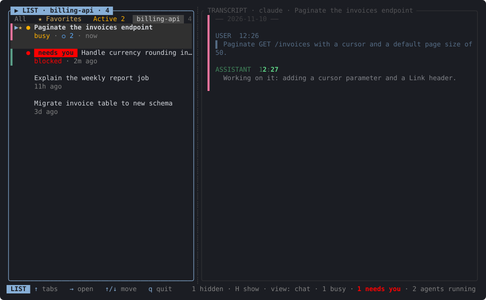
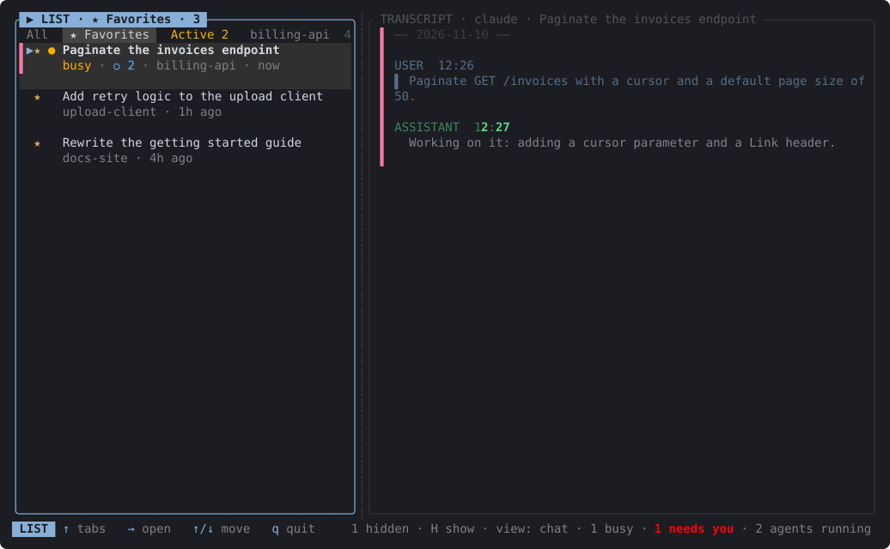
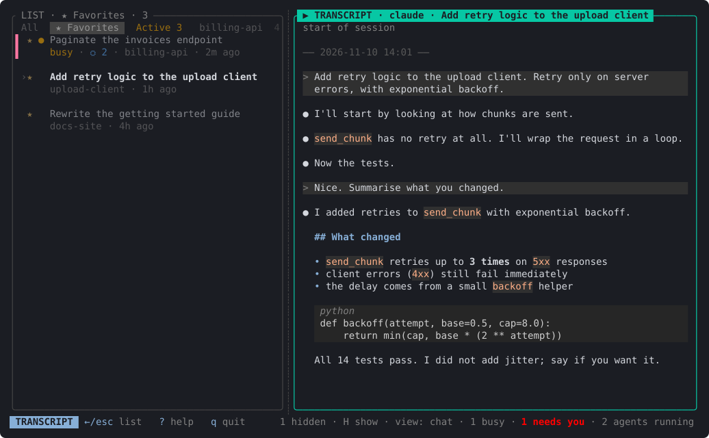
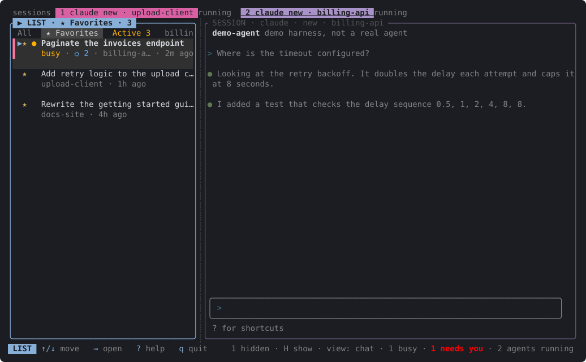

# ccview-rs

A terminal UI that lists, reads and runs your Claude Code, Codex and OpenCode sessions from one screen.


*The All tab. Each row shows a title, a status badge, the directory and the age. Rows with a live Claude process get a colour bar; the row marked `needs you` is waiting for an answer. The right pane follows the selection.*

## Why

With several agent sessions open across several projects, the questions are always the same: which one was I working on, which are busy, which is waiting for me, and where did that conversation end up. ccview-rs answers them in one place. It reads the sessions the agents already keep on disk, shows which Claude sessions are running right now, lets you read a transcript, and lets you resume, fork or start a session in an embedded terminal pane without leaving the UI.

## Screenshots

All screenshots are generated from synthetic data (invented projects and sessions, a fake harness instead of a real agent). See [Regenerating the screenshots](#regenerating-the-screenshots).



*One tab per directory. Here the `billing-api` tab lists only the sessions started there, across harnesses.*



*The Favorites tab shows the starred sessions. `s` or space toggles the star.*



*A transcript at the `chat` level: messages and rendered markdown, tool calls reduced to the essentials.*


*The `tools` level adds tool calls with their results; an `Edit` is shown as a coloured diff.*


*Two embedded sessions. The strip at the top lists running sessions; the right pane is a live terminal. The agent here is a small fake script.*



*The split between list and detail pane is adjustable (`<` and `>`), and the ratio is remembered.*

## Features

- One list of sessions from Claude Code, Codex and OpenCode, newest first, with tabs for All, Favorites, Active and one per directory.
- Live status for Claude sessions: busy, idle, and `needs you` when a session is waiting for input, plus running sub-agents. The footer summarises the counts and the Active tab lists every running session, blocked ones first.
- Transcript reader with three levels (`chat`, `tools`, `everything`, cycled with `v`), rendered markdown, code blocks and diffs. The transcript follows a session that is still being written.
- Resume, fork, continue the latest, or start a new session in an embedded terminal pane, or in a separate macOS terminal window.
- Several embedded sessions at once, each with its own identity colour, and a strip showing which are running.
- Favourites, hiding sessions from the list, and per-session colours, all remembered between runs.
- Export a transcript to HTML, Markdown or JSONL from the command line.

## Supported harnesses

| | Claude Code | Codex | OpenCode |
|---|---|---|---|
| List and read sessions | yes | yes | yes |
| Resume, fork, continue, new | yes | yes | yes |
| Attach to a background session (`a`) | yes | no | no |
| Live status, needs-you, sub-agent badges | yes | no | no |

Codex and OpenCode launch support is only tested against fake binaries, not the real programs.

## Install

Requirements: a Unix system (macOS is the target; opening a session in an external terminal window is macOS only) and a Rust toolchain.

```sh
git clone https://github.com/vriken/ccview-rs
cd ccview-rs
cargo build --release
cargo install --path .
```

The binary is `ccview-rs`. There is no crates.io or Homebrew release.

## Usage

```sh
ccview-rs
```

With no arguments it starts the UI. Other invocations skip the UI:

```sh
ccview-rs --export out.html [--file session.jsonl]
ccview-rs --live
ccview-rs --file session.jsonl
```

`--export` writes `.html`, `.md` or `.jsonl` (the latest session if `--file` is omitted), `--live` prints the running Claude sessions, and `--file` prints one Claude transcript to the terminal.

### Keys

The UI has three zones, and one is focused at a time: the list, the transcript and an embedded session.

| Where | Key | Action |
|---|---|---|
| List | `Up`/`Down` (or `k`/`j`) | Move between sessions; `Up` from the first row goes to the tab bar |
| List | `Right`, `l`, `Enter`, `Tab` | Open the selected session in the right pane |
| Tab bar | `Left`/`Right`, `h`/`l`, `[` `]` | Switch tab |
| Tab bar | `Down`, `Enter`, `Esc` | Back to the rows |
| List, transcript | `r` | Resume |
| List, transcript | `f` | Fork |
| List | `n` | New session in the selected session's directory |
| List | `c` | Continue the latest session in that directory |
| List | `a` | Attach to a Claude background session |
| List, transcript | `o` / `O` | Open resume / new in an external macOS terminal window |
| List, transcript | `s` or space | Toggle favourite |
| List | `x` | Hide the session (only from this list; transcripts are untouched) |
| List | `H` | Show hidden sessions |
| List, transcript | `C` | Cycle the session colour |
| List, transcript | `v` | Cycle `chat`, `tools`, `everything` |
| Transcript | `Up`/`Down`, `PgUp`/`PgDn`, `g`/`G` | Scroll, top, end |
| Transcript | `Left`, `h`, `Esc`, `Tab` | Back to the list |
| Anywhere outside an embedded session | `<` `>` | Resize the split |
| List, transcript | `q` or `Ctrl+C` | Quit (asks first while embedded sessions are running) |

The footer shows the essential keys for the focused zone. `?` opens a help screen that lists every key, and `,` opens settings: identity colours, view level, mouse capture, split ratio, the terminal app for `o`, hidden sessions and the Claude agent-view option.

### Embedded sessions

Everything you type goes to the agent in the pane, including `Ctrl+C`. The only key ccview-rs takes is the prefix, `Ctrl+Space`, followed by one of:

| After `Ctrl+Space` | Action |
|---|---|
| `l` or `Esc` | Back to the list |
| `x` | Close the session (asks first) |
| `[` `]` or `Left`/`Right` | Previous or next embedded session |
| `PgUp`/`PgDn` or `Up`/`Down` | Scroll the pane's history |
| `C` | Cycle the colour |
| `<` `>` `=` | Resize or reset the split |
| `Ctrl+Space` | Send a literal `Ctrl+Space` to the agent |

An unknown key after the prefix is dropped. As a shortcut, `Left` returns to the list when the cursor is at the start of the prompt (only prompt glyphs, box drawing or whitespace to its left). When an embedded process exits successfully, focus returns to the list; a key press on an exited pane dismisses it. Launching a session that is already open in a pane asks for confirmation instead of opening a second copy.

### How new sessions work

Pressing `n` runs the harness's plain launch command in the selected session's directory, inside an embedded pane titled `new · <directory>`. For Claude that is `claude` with `CLAUDE_CODE_DISABLE_AGENT_VIEW=1` set and a fixed list of inherited session-identity variables removed, so a session started from inside another Claude session does not think it is nested. Variables you set yourself, such as `CLAUDE_CODE_USE_BEDROCK`, are kept. Resume, fork and continue use the same environment.

ccview-rs does not create the session; the agent does. A Claude session that has not received a first message leaves no transcript file, so a new session does not appear in the list until the transcript exists. Until then it is visible as the pane and in the running-sessions strip. For a Claude process, ccview-rs matches the pane's process id against Claude's live session registry, learns the session id from there, and from then on treats the pane and the list row as the same session.

The title in the list follows a fixed order, and the first one present wins:

1. the custom title (set with `/rename`),
2. the agent name,
3. the title Claude generated (`ai-title`, which appears after the first exchange),
4. the first real prompt,
5. the short session id.

ccview-rs saves nothing about a session itself. The only things it stores per session are your optional favourite, hidden and colour entries, keyed by session id.

## Configuration

Files ccview-rs writes (atomically), all in `<config>/ccview-rs/`, where `<config>` is `$XDG_CONFIG_HOME` or `$HOME/.config`:

| File | Content |
|---|---|
| `favorites.json` | Starred session ids |
| `hidden.json` | Hidden session ids |
| `colors.json` | Session colour overrides |
| `view.json` | Transcript level |
| `ui.json` | `split_ratio`, `mouse`, `identity_colors`, `terminal_app`, `disable_agent_view` |

The session index cache is `index-v1.json` in `<cache>/ccview-rs/`, where `<cache>` is `$XDG_CACHE_HOME` or `$HOME/.cache`.

Environment variables:

| Variable | Effect |
|---|---|
| `CLAUDE_CONFIG_DIR` | Claude config directory (default `~/.claude`) |
| `CODEX_HOME` | Codex home (default `~/.codex`) |
| `XDG_DATA_HOME` | Location of the OpenCode database (default `~/.local/share`) |
| `XDG_CONFIG_HOME`, `XDG_CACHE_HOME` | Where ccview-rs keeps its own files |
| `CCVIEW_CLAUDE_BIN`, `CCVIEW_CODEX_BIN`, `CCVIEW_OPENCODE_BIN` | Program to launch for each harness (default `claude`, `codex`, `opencode`) |
| `CCVIEW_TERMINAL_APP` | macOS terminal app for `o`/`O` (default `Terminal`, falls back on `TERM_PROGRAM`) |
| `CCVIEW_OPEN_BACKGROUND` | Any non-empty value opens external windows in the background |

Mouse capture is on by default (it lets you drag the divider between list and pane). Set `"mouse": false` in `ui.json` to get the terminal's own selection and scrolling back; capture is then switched on only while a running embedded session that asked for mouse input is focused.

## What it reads and writes

It reads, and never modifies: Claude's `projects` and `sessions` directories and `daemon.lock`, the Codex home, and the OpenCode database (opened read-only). Its own files are the ones listed under Configuration, plus the file you name with `--export` and a temporary `.command` script when you open a session in an external terminal window.

The one Claude subcommand it runs on its own is the read-only `claude agents --json`, used for live status, and only if Claude's daemon is running.

## Privacy

Everything is local. There is no HTTP client or other network code in `src` (checked with `rg` for `http`, `reqwest`, `hyper`, `ureq`, `TcpStream` and `UdpSocket`), and nothing is sent anywhere by ccview-rs. The agents you launch from it talk to their own services as they normally do.

## Development

[AGENTS.md](AGENTS.md) is the reference for architecture, conventions, tests and the safety rules (never start a real agent from tests or tools, never touch real config directories). In short:

```sh
cargo build
cargo test
```

### Regenerating the screenshots

```sh
docs/screenshots/regenerate.sh
```

The script builds the release binary and a small capture tool, creates a synthetic home directory with invented sessions (Claude, Codex and an OpenCode database), starts a few dummy `sleep` processes so some sessions look live, and runs the real binary in a pseudo-terminal at 120 by 34 with a fake agent script in place of `claude`, `codex` and `opencode`. It drives the UI with scripted keys and writes one SVG per scene next to the script. It uses only temporary directories and never reads or writes your real configuration. It needs Python 3 and the capture tool's dependencies (`portable-pty`, `vt100`) in the local cargo cache, since it builds offline.

## Status

Early and a personal project, developed mainly on macOS. Unix only. Claude Code is the main harness; Codex and OpenCode support is thinner, and live status exists only for Claude. OSC 8 hyperlinks are not rendered in embedded panes. Embedded Claude behaviour past the trust dialog is not covered by tests that use the real program.

License: not yet specified.
