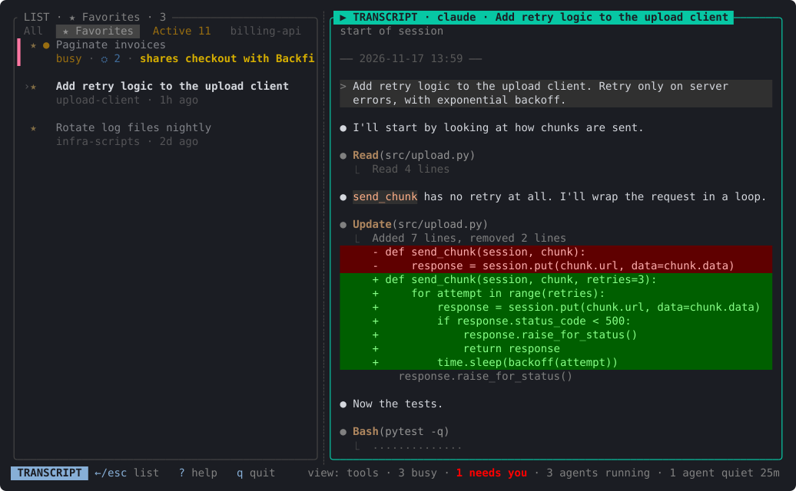
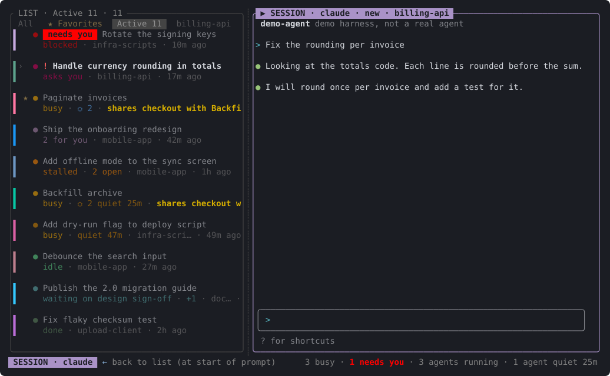

# ccview-rs

A terminal UI for keeping track of your coding-agent sessions.

If you use Claude Code, Codex or OpenCode across several projects you end up with a pile of sessions and no good answer to "which one is waiting on me, which one is stuck, where did that conversation go?" ccview-rs puts them in one list, shows what each one is doing, lets you search and read any transcript, and lets you resume, fork or start a session from the same screen.


## What it does

- **One list.** Every session, newest first, with tabs for All, Favorites, Active and each project directory. Star (`s`), mark important (`i`), put on hold (`w`), drag rows into your own order. `d` stops a session after a `y/n` confirm.
- **What idle means.** An idle Claude session shows `asks you` (its last reply ends on a question), `N for you`, `waiting on <label>`, `stalled`, `done` or plain `idle`. The last four come from an optional definition-of-done file, below. Busy sessions that go quiet, quiet sub-agents and two sessions in one git checkout are flagged too. All of these are heuristics and can be wrong.
- **Search.** `/` searches titles and transcript text. Enter opens the best hit with the words highlighted; `n`/`N` step through the matches.
- **Reading.** `v` switches between chat, tools (Claude Code's own layout) and everything. Transcripts open on the latest messages and page in older ones. Links are clickable.
- **Running.** `r` resumes, `f` forks, `n` starts in an embedded pane. The real agent runs in it and keeps running if you quit ccview-rs.
- **Updating.** When the installed binary changes, the UI restarts itself in place and keeps your tab, selection and scroll.






## Definition-of-done files (optional)

If `~/.claude/dod/<date>-<session id>.md` exists, ccview-rs reads it; if not, nothing changes. `- [ ]` is open, `- [x]` done, `- [~]` waived, and a hand-off names an owner:

```
- [>] approve the final copy — owner: you — action: reply ok or send edits — why not mine: product decision
- [>] security review — owner: security-team — waiting on security review
```

Close one by writing `[>x]`. Set `"handoff_owner": "you"` in `~/.config/ccview-rs/ui.json` so other owners count as waits.

## How it works

It keeps no sessions of its own. It reads what the agents write (Claude's transcripts, registry and sub-agent files, Codex's rollouts, OpenCode's database, read-only) on background threads. Embedded sessions are real pseudo-terminals owned by a small host process, which is why they survive quitting the UI. The search index is a SQLite file in the cache directory holding every word of the transcripts it covers, so treat it like them. ccview-rs makes no network calls.

Rust and [ratatui](https://ratatui.rs). Architecture, decisions, known limits and contributor safety rules are in [AGENTS.md](AGENTS.md).

## Try it

```sh
cargo install --path . --locked
ccview-rs
```

`?` shows the keys, `,` the settings, `ccview-rs --export out.html` writes a transcript to HTML, Markdown or JSONL. The pictures are synthetic and rebuilt by `docs/screenshots/regenerate.sh`.

## Limits

Unix only, macOS is the main target. An early personal project: Claude Code is the best supported, Codex and OpenCode show the basics. The idle states, sub-agents and checkout markers are Claude only. Session restore after a reboot (`ccview-rs autostart on`) has not been tested across a real reboot.

MIT licensed, see [LICENSE](LICENSE).
